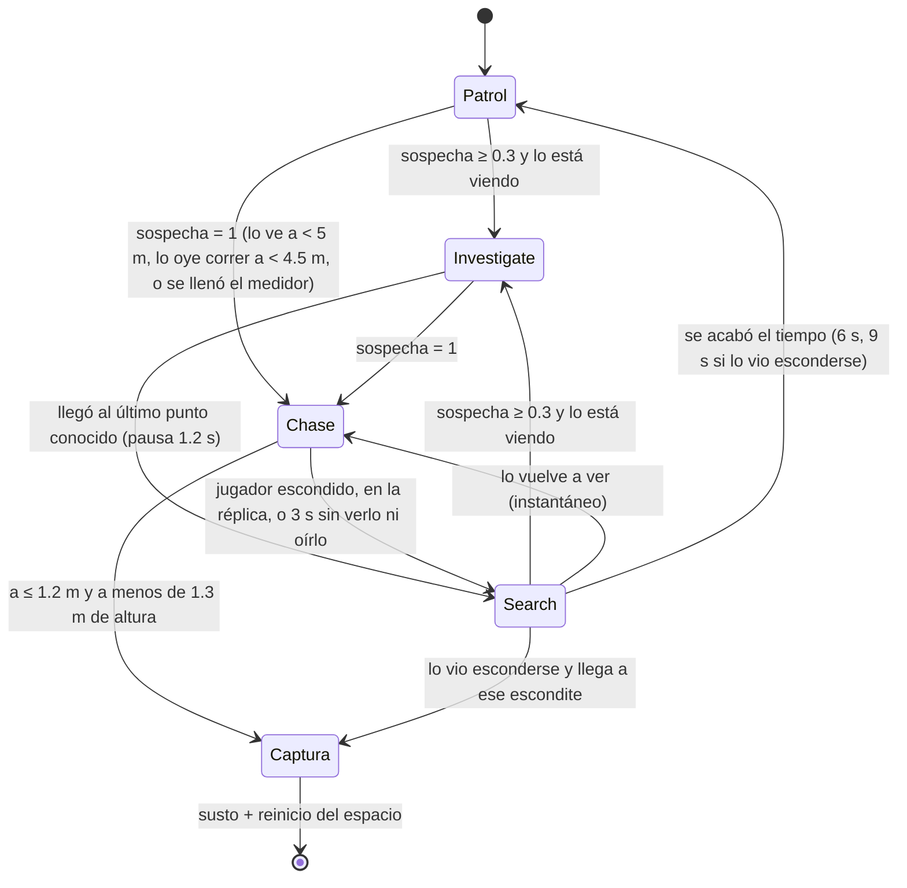

# C1 · Auditoría del jefe

Rama prevista: `polish/jefe` · Autor: Claude (sesión de Grover) · Estado: **informe listo, falta que Grover apruebe las prioridades**.

Hecho leyendo el código y los assets, **sin abrir Unity ni jugar**. Lo marcado como *probable* sale del código y hay que confirmarlo en Play. No se cambió nada del juego.

Archivos revisados: `01_Scripts/Enemy/*` (`BossAI`, `EnemyStateMachine`, `ProceduralTraversal`, `BossAudio`, `BossPosture`…), `Interaction/HidingSpot`, `Flow/HidingSpotGenerator`, `Flow/LevelContext`, `Flow/LevelFlowManager`, `Flow/SceneLoader`, `Player/PlayerController`, `Player/CameraEffects`, `UI/ScreenEffects`, `Audio/ProximityMusic`, `Audio/Sfx`, `Editor/SaltosJefeTool`, `02_Prefabs/Enemy/Boss.prefab`, `Resources/SfxBank.asset`, `Resources/GameFlowSettings.asset` y las escenas `10_Warehouse`, `11_Pools`, `12_Playground`.

---

## 1. Cómo funciona hoy

### Quién manda

- El cerebro real es **`BossAI`** (NavMesh). `EnemyStateMachine` es el prototipo del jam con física: `BossAI.Awake` lo apaga si lo encuentra. Ya no decide nada.
- El jefe **no está en ninguna escena**: lo crea `LevelContext.SetupBoss` desde `GameFlowSettings.bossPrefab` (`Boss.prefab`) en `BossSpawn`. Así que **los valores que valen son los del prefab**, no los del script.
- `LevelContext.BossEnabled` = `CurrentLevel >= 1`. **El primer espacio de la partida no tiene jefe.**

### Estados y transiciones

Además de los estados hay dos pausas: **recuperación** de 0.6 s después de cada salto o trepada (no puede atrapar), y **escuchar** (se queda quieto girando, 35 % de las veces al llegar a un punto de patrulla).

### Qué le hace ver u oír al jugador

| Sentido | Regla actual | Valor (prefab) |
| --- | --- | --- |
| Vista | Raycast desde los ojos (1.6 m) al pecho del jugador (1.2 m, o 0.5 m agachado). Cono de 110°. Si está a menos de 2.4 m lo ve aunque esté de espaldas | alcance **20 m** |
| Vista instantánea | Más cerca que esto pasa directo a persecución, sin medidor | **5 m** |
| Medidor de sospecha | Sube `1.5 × (0.35 + cercanía)` por segundo; agachado sube a la mitad; baja 0.3/s sin verlo | umbral para ir a mirar **0.3** |
| Oído | **Solo correr.** Atraviesa paredes. A menos de la mitad del alcance → persecución directa; si no, sospecha 0.6 | **9 m** |
| Invisible | Escondido (agachado dentro de un `HidingSpot`) o dentro de la tienda réplica (`IsSafe`) | — |
| "Intuición" | En patrulla, 60 % de los destinos son un punto al azar a ≤ 10 m del jugador, aunque no lo haya visto | `huntChance 0.6`, `huntRadius 10` |

### Velocidades por espacio

La dificultad **no depende del espacio sino del orden**: `LevelContext.BossSpeedMultiplier` = ×1.25 a partir del tercer espacio jugado. Como el orden de los tres espacios se baraja en cada partida, cualquier espacio puede tocar sin jefe, con jefe normal o con jefe rápido.

Valores en m/s (prefab `Boss.prefab`; el script tiene otros por defecto que no se usan):

| | Jugador | Jefe, 2.º espacio (×1) | Jefe, 3.er espacio (×1.25) |
| --- | --- | --- | --- |
| Agachado | 1.25 | | |
| Caminar / patrulla | 2.5 | 2.85 | 3.56 |
| Investigar | | 3.28 | 4.10 |
| Buscar | | 3.71 | **4.63** |
| Correr / perseguir | **4.5** (máx. 5 s de energía) | 4.0 | 5.0 |
| Arranque cerca (< 6 m y viéndolo) | | **4.8** | **6.0** |

El resto de valores de persecución: atrapa a 1.2 m, memoria 3 s, predice 0.8 s hacia adelante, busca 6 s en un radio de 6 m y revisa 2 escondites.

Al darle Play directo a un nivel en el editor, `directPlayLevelIndex = 1`: **en el editor siempre se prueba la versión ×1**, nunca la ×1.25.

### Escondites por espacio

| Espacio | `HidingSpot` en la escena | Generados al cargar | Saltos del jefe (`SaltosJefe_Auto`) | Tipo de agente NavMesh |
| --- | --- | --- | --- | --- |
| 10_Warehouse | 6 | 0 (ya hay ≥ 4) | **0** | Humanoid (0) |
| 11_Pools | 0 | hasta 8, en rincones del NavMesh | 36 | propio (-1372625422) |
| 12_Playground | 51 | 0 | 16 | Humanoid (0) |

### Captura y reinicio

`Catch` → abalanzarse (0.18 s) + `CameraEffects.Screamer` (1 s) → `RestartLevel` → fundido a negro (0.6 s) + carga + despertar con párpados (0.5 + 0.15 + 0.35 + 0.9 = 1.9 s). **Total ≈ 3.7 s más la carga**, y se repite toda la escena desde el principio.

---

## 2. Problemas encontrados

Gravedad como en `BUGS.md`. **Seguro** = se ve en el código o en los assets. *Probable* = hay que confirmarlo jugando.

| # | Gravedad | Qué pasa | Por qué | Seguro / probable |
| --- | --- | --- | --- | --- |
| P1 | **Alta** | El jefe te ve y **no suena ningún aviso** | `BossAI` llama a `Sfx.Play("boss_alert")`, pero ese id **no existe en el `SfxBank`**. Solo sale un warning en la consola | Seguro |
| P2 | **Alta** | **No se respira**: el jefe camina en silencio salvo los pasos | `BossAudio.breathLoop` está vacío en `Boss.prefab`, aunque existe `08_Audio/SFX/enemy breathing.mp3` | Seguro |
| P3 | **Alta** | En el 3.er espacio la persecución **no se puede escapar corriendo** | Buscar (4.63), perseguir (5.0) y arrancar (6.0) son más rápidos que correr (4.5). Y la energía dura 5 s | Seguro (números) |
| P4 | **Alta** | Incluso en el 2.º espacio, **correr no sirve para escapar** | Correr hace ruido a 9 m **a través de paredes**, y oír cuenta como "verlo": se renueva la memoria de 3 s y la persecución nunca termina mientras corras cerca. Cuando se acaba la energía caminas a 2.5 contra 4.0. Solo te salva un escondite o la réplica | Seguro (código); confirmar sensación jugando |
| P5 | Media | La curva "el almacén enseña, las piscinas presionan, el parque aprieta" **no se puede hacer hoy** | La dificultad va por orden barajado, no por espacio. El primer espacio no tiene jefe, sea cual sea | Seguro |
| P6 | Media | Te atrapan **a la vuelta de una esquina sin margen** | A menos de 5 m pasa directo a persecución; con arranque de 4.8–6.0 m/s cubre 3.8 m (5 m − 1.2 m) en menos de 0.8 s. El único aviso es la viñeta, que tarda en subir (1.5/s) | Probable |
| P7 | Media | Esconderte **en medio de una persecución** = muerte casi segura, y el jugador no entiende por qué | Si te estaba viendo hasta 0.5 s antes de agacharte, guarda el escondite, va directo y te saca. No hay ninguna señal de "te vio entrar" | Seguro (regla); claridad: probable |
| P8 | Media | Puede **atraparte a través de una pared fina** | La captura solo mira distancia plana (1.2 m) y altura, no si hay línea de vista | Probable |
| P9 | Media | En el almacén, **subirse a un bloque de 2 m deja al jefe abajo para siempre** | El almacén no tiene NavMeshLinks (0 saltos). Por encima de 1.3 m de diferencia no atrapa | Probable |
| P10 | Media | El jefe **siempre anda cerca** aunque nunca te haya visto | 60 % de la patrulla va a ≤ 10 m de ti. Con 9 m de oído, cualquier carrera lo trae | Seguro (código); si es bueno o malo lo decide el playtest |
| P11 | Media | Morir **tarda ~4 s y repite todo el espacio** | Ver "Captura y reinicio" arriba | Seguro |
| P12 | Baja | **No detecta atascos** | Solo la patrulla reacciona a una ruta incompleta. En investigar/buscar/perseguir, si no puede llegar se queda empujando hasta que se acaba un temporizador (o nunca, en persecución, si te sigue oyendo) | Probable |
| P13 | Baja | Escondites **solapados** pueden "soltar" al jugador | `HidingSpot.OnTriggerExit` pone `InHidingSpot = false` aunque siga dentro de otro escondite. En el parque hay 51: revisar si se pisan | Probable |
| P14 | Baja | Escondites generados en las piscinas **sin colisión** y con **cubos de colores** | `HidingSpotGenerator` crea cajas primitivas sin collider y con material por defecto teñido: se ven de programador y se pueden atravesar | Seguro |
| P15 | Baja | `BossPosture.maxSpeed = 4.4` está fijo y no sigue la velocidad real | Con ×1.25 la inclinación se satura antes de tiempo. Detalle visual | Seguro |
| P16 | Baja | `SetDestination` en cada frame en investigar y perseguir | Recalcula la ruta 60 veces por segundo; en WebGL puede costar | Probable (medir en B5) |

---

## 3. Propuesta para C2 a C6, por prioridad

Orden recomendado: lo que hoy hace que el juego se sienta injusto va primero.

### 1.º · C2 · Dificultad en datos (arregla P3, P5 y prepara el resto)

- `BossTuning` (ScriptableObject) con: velocidades de patrulla, búsqueda, persecución y arranque; alcance de vista, vista instantánea y oído; ganancia de sospecha; memoria; tiempo de búsqueda; enfriamiento entre persecuciones. Assets `Boss_Warehouse`, `Boss_Pools`, `Boss_Playground` en `Assets/07_data/Boss/`.
- **Regla de diseño**: la persecución nunca más rápida que correr (4.5). Propuesta inicial: perseguir 3.6 / 3.9 / 4.2, arranque ×1.1, buscar < 3.5 en los tres.
- `LevelContext`: cambiar solo `BossSpeedMultiplier` (y quizá `BossEnabled`) para que lea el tuning. Anotarlo en `PROGRESO.md` porque el archivo es de Rafael.
- **Decisión que necesito de Grover** (ver final): curva por espacio o por orden.

### 2.º · C3 · Avisos (arregla P1, P2, P6)

- Mientras Alan no entregue `boss_warn`: pedirle también `boss_alert` (hoy falta) y poner `enemy breathing.mp3` en `breathLoop` del prefab.
- Al pasar a persecución: medio segundo de "te vio" (se frena, gira hacia ti, suena) antes de acelerar. Así siempre hay un momento para reaccionar.
- Luces cercanas que fallan: `LightFlicker` ya existe en las escenas; el jefe solo tiene que avisarles cuando está a menos de X m.
- Viñeta: que suba más rápido al pasar a persecución.

### 3.º · C4 · Escondites justos (arregla P4, P7, P13, P14)

- Oído: que correr **detrás de una pared** se oiga a la mitad de distancia, y que oír no cuente como "verlo" para la memoria de persecución.
- Si el jefe te vio entrar a un escondite: que se note (te mira, sonido corto). Así el jugador entiende por qué lo sacaron.
- Feedback al estar escondido: respiración, borde oscuro suave, quizá agacharse más.
- Escondites generados: cajas con collider y el material de cartón del kit (cuando exista B1).

### 4.º · C5 · Muerte y reinicio rápido (arregla P11)

- Susto igual (1 s). Después, fundido corto y despertar abreviado: objetivo < 3 s en total.
- Frases de reintento cortas y variadas (en `GameFlowSettings`, editables).
- Ojo: `SceneLoader` y `LevelFlowManager` son de Rafael (bloque E). Propuesta: un modo `Reveal.Retry` más corto, pedido a Rafael en `PROGRESO.md`, o que lo hagamos nosotros con su permiso.

### 5.º · C6 · Navegación y atascos (arregla P8, P9, P12, P16)

- Hornear saltos en el almacén (`Tools/Kit/Generar saltos del jefe`) o confirmar que no hay bloques a los que subirse.
- Detector de atasco: si en 3 s se movió menos de 0.5 m queriendo moverse, recolocarlo en un punto del NavMesh fuera de la vista del jugador.
- Captura con línea de vista.
- Recalcular la ruta cada 0.2 s en lugar de cada frame.
- Prueba de 10 minutos por espacio.

---

## 4. Lo que tiene que decidir Grover

1. **Curva por espacio o por orden.** El plan pide "el almacén enseña, las piscinas presionan, el parque aprieta", pero el orden se baraja. Opciones:
   - **A** · Fijar el orden: almacén → piscinas → parque. Más simple y la curva sale sola. Toca `LevelFlowManager` (Rafael).
   - **B** · Orden barajado y dificultad por posición (1.º / 2.º / 3.º), con `BossTuning` por posición. El espacio decide el ambiente, no la dificultad.
   - **C** · Orden barajado y dificultad por espacio. Puede tocar el parque primero, que sería el más difícil.
   - Recomiendo **A** o **B**.
2. **¿Jefe en el primer espacio?** Hoy no hay jefe en el primer espacio. Si se elige A, el almacén quedaría sin jefe (solo para explorar). Propongo dejar un jefe muy lento y poco atento en vez de ninguno.
3. **¿Se mantiene la "intuición"** (60 % de la patrulla cerca del jugador)? Da tensión, pero hace que nunca haya un momento de calma. Propongo bajarla a 0.3–0.4 en el primer espacio.
4. **Aprobar el orden C2 → C3 → C4 → C5 → C6.**
